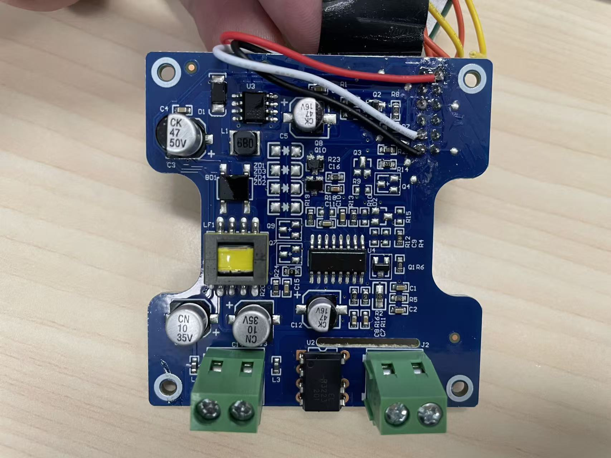
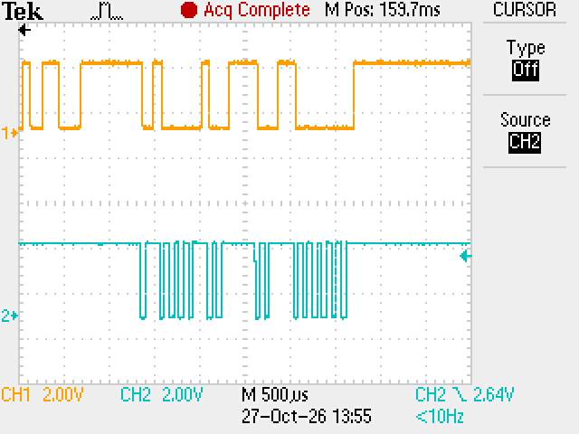
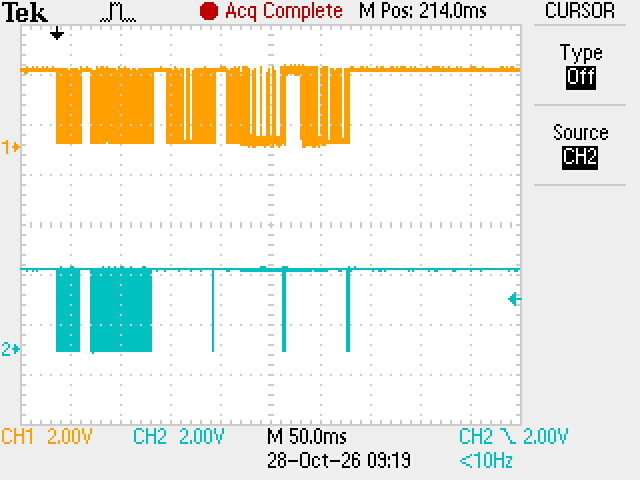

# York H-Link Two-Wire Bus Protocol Reverse Engineering and IR Control

Target: the York **YCWA16NCWQ** wired panel. The panel talks to the indoor unit over the **H-Link A/B two-wire polarity-free bus** (low-voltage DC power supply + data on the same two wires). Findings:

- The panel is a **closed setting authority** on the bus - listen-only is safe and complete.
- Control goes over **infrared** (a 184-bit HITACHI_AC3 full-state frame), equivalent to "a person pressing a key" - zero bus traffic, zero risk.

This project publishes the working results only: **tapping the running status between the power & modem board and the control panel** (bus listen-only) plus **infrared control**. Example sketches live in [`examples/`](examples/). (The full Chinese write-up is in [README.zh-CN.md](README.zh-CN.md); this file is a condensed English version.)

---

## 1. System Structure and Access Point

```
A/B two-wire bus (low-voltage DC power + data, polarity-free)
        |
   +----+------------+
   | Power & modem  |  filtering -> common-mode choke -> bridge -> 5 V; modem circuit
   | board           |
   +----+------------+
        |  4-wire harness: +5V / GND / TX / RX
        |  adapter board (ESP8266) taps 3 of them: +5V / GND / RX (listen-only, TX not used)
   +-----------------+
   |  control panel  |  panel MCU + display + IR receiver
   +-----------------+
```

Adapter board wiring (ESP8266 NodeMCU):

| Pin | Purpose | Notes |
| --- | --- | --- |
| D2 / GPIO4 | **IR transmit** | GPIO -> 100 ohm -> IR LED, direct drive (no MOSFET); peak ~15-20 mA at 50% duty; proven to reach the panel |
| D6 / GPIO12 | **Bus receive** | modem board demodulated data output (RX line), 9600 8E1 software serial, always on |

Power for the board: harness +5 V -> AMS1117-3.3.



The adapter is soldered with only 3 wires into the 4-wire harness: +5V / GND / RX (the soldered wires in the photo).

## 2. Physical Layer Findings

| Item | Measured value |
| --- | --- |
| Bit width | **105.31 us -> 9600 bps** (87 edges fitted to one grid, RMS 7.5 us) |
| Per character | **1263.7 us = 12 bits** = start + 8 data (LSB first) + parity + **2 stop** (wire is 9600 8E2; receiving with 8E1 samples parity + first stop correctly) |
| TX encoding (panel side) | **0 = 60 us low + 45 us high; 1 = 105 us high**; bytes back-to-back with zero gap |
| RX line (echo line) | NRZ, idle high - **every TX edge is echoed on RX** |
| Frame length | 18 B frame = **22.75 ms**; 39 B ~ 50 ms; 48 B ~ 60 ms |
| Parity bit | even parity for data bytes; the **address byte's 9th bit is always 1** (address mark - shows up as a parity error, i.e. message boundary) |
| Bus rhythm | idle in steady state; **heartbeat every ~30 s**; extra traffic only after key presses |

**Echo mechanism**: RX is a purely physical conversion of TX - a falling-edge-triggered re-triggerable monostable (~1 bit clock, 105-150 us) stretches each 0-bit's 60 us low pulse to a full bit width, consecutive 0s merge into one low stretch, edges aligned with TX. Therefore **one 9600 8E1 software serial port receives ALL traffic - panel (0x21) and indoor unit (0x12) frames alike**. This is the physical basis of "tapping the running status between the power & modem board and the control panel".

## 3. Link-Layer Protocol

### 3.1 Message Format and Checksum

- Message = `[addr][00][len][payload][chk]`; `addr` = `0x21` (panel) / `0x12` (indoor unit); `len` = total bytes incl. header (self-describing).
- Checksum: `chk = XOR(byte[1] .. byte[n-2])`, address byte excluded; valid for 18B/39B/48B alike.
- Inter-frame idle 8.7-13.4 ms.

### 3.2 ACK

- `[peer addr][0x06]`, fixed 2 bytes, no checksum, same 12-bit characters, follows every message.
- **Lost ACK -> the sender retransmits the whole frame (byte-identical); receivers must tolerate duplicate frames.**
- ACK duty: **the panel only ACKs sessions it initiated itself**.



### 3.3 Frame Types and Transaction Model

| Frame | Direction | Role |
| --- | --- | --- |
| **18B** | panel -> indoor | settings: power / mode / set temperature / fan |
| **39B** | indoor -> panel | status: power / mode / temperatures / compressor / blower / fan |
| **48B** | both directions | config block; on a settings change `idx14` (panel) / `idx16` (indoor) = `0x40` for one round |

One heartbeat = two request-response rounds: panel 18B <-> indoor ACK + 39B; panel 48B <-> indoor ACK + 48B. The order of the two rounds is not fixed -> identify frames by header, not by order.

- **Settings echo immediately**: the 39B right after a key press already carries the new setting; what lags one beat is the **running state** (blower / compressor start-stop).
- **Event-driven 39B pushes**: blower starts `idx11 18->38`, compressor starts `38->58`, one frame each.
- Ruled out (measured): 39B `idx13` constant `0xD0`; 39B `idx19` constant `0x03`; 18B `idx15` constant `0x04`; "silent mode" lives in the 48B config block.



### 3.4 Field Table (all verified by measurement)

| Field | Location | Encoding |
| --- | --- | --- |
| Power | 18B / 39B `idx10` bit0 | 1 = on / 0 = off |
| Mode | 18B / 39B `idx10` bit3..6 | `0x08` cool / `0x10` dry / `0x20` fan / `0x40` heat; 18B always also sets `0x80`, 39B does not |
| Set temperature | 18B / 39B `idx12` | integer deg C. 0.5 C never enters the protocol (panel display pseudo-precision); **switching to heat auto-jumps the setpoint to 20 C**, restored when switching away |
| Room temperature | 39B `idx33` | integer deg C |
| Compressor running | 39B `idx11` bit6 | 1 = running (forced 0 while locked out / faulted) |
| Indoor blower running | 39B `idx11` bit5 | 1 = running; power-up order: off `12` -> blower `32` -> compressor `52`, reversed at shutdown |
| Fan speed | 18B / 39B `idx11` low nibble | one-hot 3 levels: `0x08` = 1-2 (weakest) / `0x04` = 3-4 / `0x02` = 5-6 (strongest); 18B `idx11` = `0x10 \| speed code` |
| Fan sub-level | 39B `idx37` | synced with 18B `idx16` bit4. Full 6-level table (speed code, sub): 1=(08,06) 2=(08,04) 3=(04,06) 4=(04,04) 5=(02,04) 6=(02,06) |
| Settings-changed flag | 48B `idx14` (panel) / `idx16` (indoor) | `0x40` on the key-press round, cleared next round |

Protocol conclusion: the panel is the command initiator, the indoor unit is the executor/reporter.

### 3.5 Frame Samples (checksum-verified, parsing reference)

18B settings frame template = `21 00 12 02 01 01 02 01 02 B1` + `idx10` + `idx11` + `idx12` + `10 85 04` + `idx16` + `chk`:

| Action | idx10 | idx11 | idx12 | idx16 | Full frame |
| --- | --- | --- | --- | --- | --- |
| OFF, cool 24 C | 88 | 12 | 18 | 21 | `21 00 12 02 01 01 02 01 02 B1 88 12 18 10 85 04 21 92` |
| ON, cool 24 C | 89 | 12 | 18 | 21 | `21 00 12 02 01 01 02 01 02 B1 89 12 18 10 85 04 21 93` |
| ON, dry 24 C | 91 | 12 | 18 | 21 | `21 00 12 02 01 01 02 01 02 B1 91 12 18 10 85 04 21 8B` |
| ON, heat 20 C | C1 | 12 | 14 | 21 | `21 00 12 02 01 01 02 01 02 B1 C1 12 14 10 85 04 21 D7` |
| ON, fan 24 C | A1 | 12 | 18 | 21 | `21 00 12 02 01 01 02 01 02 B1 A1 12 18 10 85 04 21 BB` |
| fan level 1 | 89 | 18 | 19 | 31 | `21 00 12 02 01 01 02 01 02 B1 89 18 19 10 85 04 31 88` |
| fan level 3 | 89 | 14 | 19 | 31 | `21 00 12 02 01 01 02 01 02 B1 89 14 19 10 85 04 31 84` |
| fan level 6 | 89 | 12 | 19 | 31 | `21 00 12 02 01 01 02 01 02 B1 89 12 19 10 85 04 31 82` |

48B config block template = `21 00 30 02 01 01 02 01 02 BD 00 00 FF FF` + `idx14` + `00 41 00` + 27x `00` + `38 06 00` + `chk` (steady state `idx14=00`, tail `F1`; settings-changed round `idx14=40`, tail `B1`).

39B status frame reference (ON, cool 24 C, compressor starting):

```
12 00 27 01 02 01 01 01 01 B1 09 12 18 D0 00 00 04 20 00 03 00 00 00 00 00 13 1E 03 18 40 00 20 00 1B 00 00 00 04 08
```

### 3.6 Receive Filter (checksum gate)

```
frameLenAt(k):
  (1) capByte[k] in {0x21, 0x12}       - address header
  (2) capByte[k+1] == 0x06             - ACK, fixed 2 bytes
  (3) want = capByte[k+2]; try L = want..want-4:
        XOR(byte[k+1]..byte[k+L-2]) == byte[k+L-1]  -> hit, frame length = L
  (4) no hit -> drop 1 byte and resynchronize
```

Principle: **only accept checksum-consistent frames**; interference fragments and mis-aligned soft-serial stitches are dropped with byte-wise resync. (Long frames occasionally lose `0x00` bytes - the XOR checksum is insensitive to that, hence the tolerance of 4 bytes.)

## 4. Infrared Control

### 4.1 Protocol = HITACHI_AC3, 184-bit "Normal" state frame (23 bytes, MSB first, 38 kHz)

Measured timing matches the IRremoteESP8266 constants exactly:

| Item | Measured | Library constant kHitachiAc3 |
| --- | --- | --- |
| Header mark / space | 3414~3500 / 1568~1656 us | 3400 / 1660 us |
| Bit mark | 416~560 us | 460 us |
| Space 0 / 1 | 382~416 / 1216~1250 us | 410 / 1250 us |
| **Footer mark** | 460 us (**mandatory**) | kHitachiAc3BitMark |
| Footer gap | ~100 ms | kHitachiAc3Gap = 100000 us |
| Frame length | 184 bits = 23 bytes ("Normal" variant) | kHitachiAc3StateLength-4 |

**The footer mark must not be omitted**: a real remote frame has rawlen = **372** edges = header 2 + 184 bits x 2 (368) + **footer mark 1** + final gap. Hand-rolled senders with footermark = 0 produce 370 edges; every data bit is correct and the panel still drops the frame ("carrier present, pulses present, panel unmoved"). "Last mark + long gap" is the panel decoder's termination condition.

**Send every command twice** (`repeat=1`): the receiver's AGC desensitizes after long frames.

### 4.2 Bit Order (key finding)

**The remote sends MSB-first; the library `sendHitachiAc3()` sends LSB-first (`MSBfirst=false`) - the same bytes become per-byte bit-reversed on the wire.** Feeding raw remote bytes to the library produces mirrored garbage that the panel always drops. Fix (either way, identical waveforms):

- store **pre-reversed (Rev8) bytes** in the code table; the library's LSB-first transmission then restores the remote's MSB-first stream (used by Example 02 here);
- or bypass `sendHitachiAc3` and call `IRsend::sendGeneric(..., MSBfirst=true, ...)` with the **original remote bytes**.

Warning: never validate bit order with "we sent it, we received it" - that is circular. Use a real remote capture or the panel's reaction.

### 4.3 Frame Structure and Code Tables (all captured from the real remote)

The whole frame is built from "value + inverted value" complement pairs: byte17 = (mode << 4) \| fan and byte18 = ~byte17; temperature byte15/16 and power byte21/22 are isomorphic.

**Power frame (23-byte full-state frame)** - used for on/off and every parameter, one command carries all parameters:

| Field | Bytes | Encoding |
| --- | --- | --- |
| Power | byte21 / 22 | ON = `09/F6`, OFF = `05/FA` |
| Temperature | byte15 / 16 | code / ~code, table below |
| Mode x fan | byte17 / 18 | high nibble = mode, low nibble = fan |

Fixed bytes: `C0 0C 00 02 FD FF 00 67 98 91 6E 80 7F FC 03 A4 5B 69 96 80 7F` (byte0..14, 19..20).

Power-off frame raw bytes (remote bit order, MSB-first):

```
C0 0C 00 02 FD FF 00 67 98 91 6E 80 7F FC 03 A4 5B 69 96 80 7F 05 FA
```

**Temperature codes (byte15; all 16 codes for 16-31 C captured)**:

```text
C  : 16   17   18   19   20   21   22   23   24   25   26   27   28   29   30   31
hex: C8   A8   E8   98   D8   B8   F8   84   C4   A4   E4   94   D4   B4   F4   8C
```

The panel only accepts 19-30 C (out-of-range is clamped); out-of-range codes have no effect.

**Mode high nibble (byte17 high 4 bits, cause-effect verified)**: heat = 1, dry = 2, fan = 4, cool = 6. (The AUTO code has not been captured yet; send cool instead; capture by diffing one AUTO key press.)

**Fan low nibble (byte17 low 4 bits, labeled by actual airflow as seen on the bus)**:

| Code | Meaning | Bus 39B evidence |
| --- | --- | --- |
| 0x3 | max fan | speed = 5-6 (02/06) |
| 0x5 | mid fan | speed = 3-4 (04/06) |
| 0x9 | min fan | speed = 1-2 (08/06) |
| 0x1 | auto | **the panel has no auto fan level, do not use** |

Note: the remote's displayed level numbers 1..6 are reversed relative to the actual airflow (displayed level 1 = max fan).

**Temperature short frame (17 B, backup path)**: the temperature key sends a shorter frame (first 17 bytes only, byte7/8 = `C7 38`, byte11/12 = `90 6F`, byte15/16 = temperature code / ~code). Verified 12 times that the panel accepts it; but the full power frame already carries every parameter, so the short frame is kept as a backup only. The mode-key short frame (`A0 5F` marker) is not used.

### 4.4 Hardware (final)

| Item | Solution |
| --- | --- |
| Transmit | **D2 direct drive** (no MOSFET): pin -> 100 ohm -> IR LED, peak ~15-20 mA (50% duty), proven sufficient |
| Carrier | 38 kHz, matches the panel |

### 4.5 Troubleshooting Chain (field-proven)

- Every data byte matches yet the panel does not react -> almost certainly a **missing frame-tail piece** (footer mark not sent) or a single transmission (AGC needs two).
- AC IR protocols use **full-state frames** (power + mode + temperature + fan together), not key codes; **byte-diff** adjacent key frames to locate fields.
- The remote sends each key once; the panel reports the new state over the bus 0.8-1.4 s later (the panel is the setting authority - IR changes to it are always adopted).

## 5. Example Code

Minimal sketches (ESP8266 / Arduino) live in [`examples/`](examples/):

| Example | Interface | What it does |
| :--- | :--- | :--- |
| [01_hlink_bus_monitor](examples/01_hlink_bus_monitor/) | H-Link RX line (power & modem board <-> control panel) | **RX only**: decodes all checksum-validated frames (18B/39B/48B/ACK) and prints the running state: power, mode, set temperature, room temperature, compressor, blower, fan level |
| [02_ir_control](examples/02_ir_control/) | IR LED on D2 | sends the HITACHI_AC3 184-bit state frame: power, mode, set temperature, fan |

Both combine into one board (the deployed form: D6 = bus RX, D2 = IR TX) - **bus listening for status, IR for control**.

## 6. Evidence Files

Raw oscilloscope captures and screenshots are in [`img/evidence/`](img/evidence/):

- `F0000~F0006TEK.JPG`: early waveform measurement screenshots;
- `CH1/CH2 .csv` files of F0008 / F0023 / F0025 / F0026 / F0027: raw samples of the bus and panel TX;
- `F0018/F0019`: panel-to-indoor-unit ACK, 2 us sampling;
- `F0023`: ACK timing;
- `F0025/F0026/F0027`: the real-panel power-off transaction, segmented and full view (matches the frame samples in section 3);
- `问答时间.JPG`: bus traffic vs. key-press timing.

The CSV data can be re-plotted with any tool; the screenshot file names are the measurement subjects.
