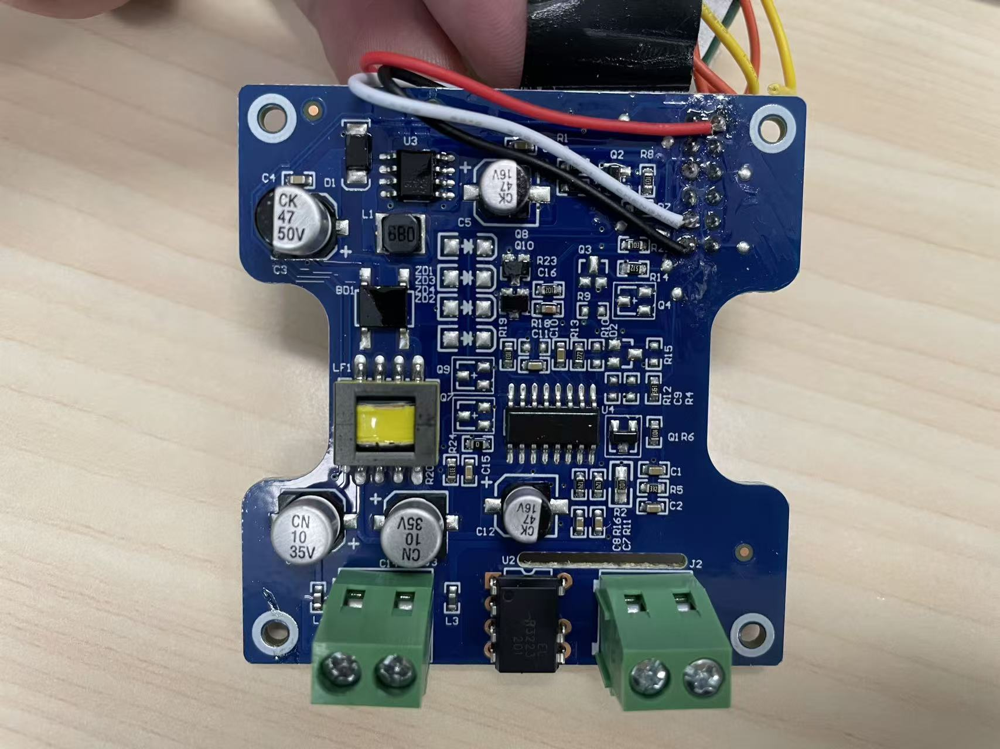
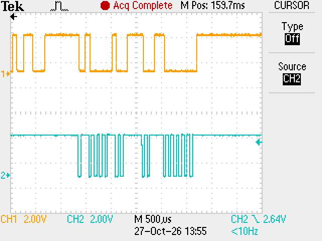
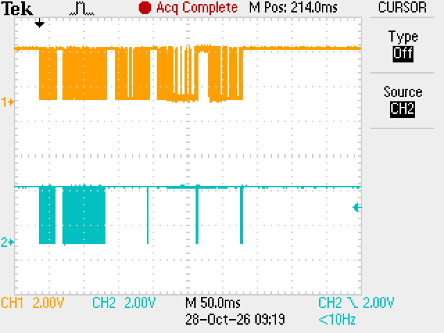

# 约克 H-Link 两线总线协议逆向与红外控制

对象是约克 **YCWA16NCWQ** 线控面板。面板与内机之间走 **H-Link A/B 两线无极性总线**（低压直流供电 + 数据复用）。研究结论：

- 面板是总线上的**封闭设定权威**——总线只收不发，监听运行状态安全且完整；
- 控制一律走**红外**（HITACHI_AC3 184 位全状态帧），等价"人按按键"，零风险。

本项目只发布可用成果：**在强电板与弱电板之间截获运行状态**（总线监听）+ **红外控制**。示例代码见 [`examples/`](examples/)。

---

## 一、系统结构与接入点

### 1.1 系统结构

```
A/B 两线总线（低压直流供电 + 数据，无极性）
        │
   ┌────┴─────┐
   │  强电板  │  滤波 → 共模电感 → 桥堆 → 降压 5V；含调制解调电路
   └────┬─────┘
        │  对外 4 线：+5V / GND / TX / RX   ← 本适配板（ESP8266）并接在这 4 根线上
   ┌────┴─────┐
   │  弱电板  │  面板 MCU + 屏幕 + 红外接收头
   └──────────┘
```

- 适配板供电：4 线中的 +5V → AMS1117-3.3。
- 连接器其余标识：buzz / EL / RST（未用）。

### 1.2 适配板接线一览（ESP8266 NodeMCU）

| 引脚 | 用途 | 说明 |
| --- | --- | --- |
| D2 / GPIO4 | **红外发射** | GPIO 串 100Ω 直接驱动红外管（不用 MOS），峰值 15~20mA（38kHz 载波占空 50%），实测驱动面板足够 |
| D5 / GPIO14 | **红外接收**（可选） | 独立一体化接收管（解调基带输出），用于发射自检 / 补采缺失码 |
| D6 / GPIO12 | **总线接收** | 调制解调板解调数据输出（RX 线），9600 8E1 软串，常开 |
| D7 / GPIO13 | 未使用 | 总线发送路线已放弃（见第四节），悬空 |



---

## 二、物理层结论

| 项 | 实测值 |
| --- | --- |
| 位宽 | **105.31µs → 9600bps**（帧内 87 边整栅格拟合，RMS 7.5µs） |
| 每字符 | **1263.7µs = 12 位** = 1 起始 + 8 数据(LSB 先) + 1 校验 + **2 停止**（线上 9600 8E2；接收配 8E1，采样点恰好落在校验位与停止位 1 上） |
| TX 编码（面板侧） | **0 位 = 60µs 低 + 45µs 高；1 位 = 105µs 高**；帧内字节零间隔背靠背 |
| RX 线（回显线） | NRZ，空闲高——**TX 上任何波形都会回显在 RX** |
| 帧长 | 18B 帧 = **22.75ms**；39B ≈ 50ms；48B ≈ 60ms |
| 校验位 | 数据字节偶校验；**首字节（地址）第 9 位恒 1** = 地址标记（按 8E1 收必然校验"错"，'!' 集中在消息首字节，即消息边界） |
| 总线节奏 | **常态空闲，心跳约 30s 一次**；其余流量只在按键后出现 |

**回显机制**：RX 是 TX 的纯物理转换——下降沿触发的可重触发单稳（≈1 个位时钟 105–150µs）：0 位的 60µs 低脉冲被拉伸为整位宽低、连续 0 位连成一段低、下降沿与 TX 逐沿对齐。因此 **9600 8E1 软串口一路接收即可同时收到面板(0x21)与内机(0x12)的全部帧**——这就是"在强电板与弱电板之间截获运行状态"的物理基础。

电气要点：TX 空闲 **3.24V**（面板在位，3.3V 逻辑），面板驱动内阻 ≈620Ω；RX 线上的 5.1k 对地 / 7.5k 对 +5V 为偏置网络。A/B 总线本体（强电板另一侧）无需关心：0 位 = 向总线灌一个 ~100µs 脉冲周期，1 位不动；空闲 24V，电平位移由调制解调板完成。

---

## 三、链路层协议

### 3.1 消息定式与校验

| 项 | 结论 |
| --- | --- |
| 消息 | `[addr][00][len][payload][chk]`；`addr` = `0x21`(面板) / `0x12`(内机)；`len` = 含头总字节数（自描述） |
| 校验和 | `chk = XOR(byte[1] … byte[n-2])`，地址字节不参与；对 18B/39B/48B 全部通用 |
| 节奏 | 帧间空闲 8.7–13.4ms |

### 3.2 ACK

- `[对端地址][0x06]` 固定 2 字节、无校验和、同为 12 位字符（8E2），紧跟每条消息后。
- **ACK 丢失 → 发送方整帧重发（内容逐字节相同），接收侧必须容忍重复帧**。
- ACK 责任：**面板只 ACK 自己发起的会话**。



### 3.3 帧型与事务模型

| 帧 | 方向 | 角色 |
| --- | --- | --- |
| **18B** | 面板→内机 | 设置帧：电源/模式/设定温度/风速 |
| **39B** | 内机→面板 | 状态帧：电源/模式/温度/室温/压缩机/风机/风速回报 |
| **48B** | 双向 | 配置块：不随状态变化；设置变更当轮 `idx14`(面板)/`idx16`(内机)=`0x40` |

一次心跳 = 两轮请求-应答：面板 18B ↔ 内机 ACK + 39B；面板 48B ↔ 内机 ACK + 48B。两轮交错顺序不固定 → 接收按帧头识别，不依赖顺序。

- **设定类字段当轮即回显**：按键当轮的 39B 已带新设定；有"一拍延迟"的是**运行状态**（风机/压缩机起停）。
- **内机事件驱动推 39B**：风机起 `idx11 18→38`、压缩机起 `38→58` 各推一条 39B。
- 非控制相关（实测排除）：39B `idx13` 恒 `0xD0`；39B `idx19` 恒 `0x03`；18B `idx15` 恒 `0x04`；静音走 48B 配置块。



### 3.4 字段总表（全部实测坐实）

| 字段 | 位置 | 编码 |
| --- | --- | --- |
| 电源 | 18B / 39B `idx10` bit0 | 1=开 / 0=关 |
| 模式 | 18B / 39B `idx10` bit3..6 | `0x08`制冷 / `0x10`除湿 / `0x20`送风 / `0x40`制热；18B 恒另带 `0x80`，39B 不带 |
| 设定温度 | 18B / 39B `idx12` | 整数℃ 直读。0.5℃ 不入协议（面板显示伪精度）；**切制热会自动把设定拉到 20℃**，切走再恢复 |
| 室温 | 39B `idx33` | 整数℃ |
| 压缩机运行 | 39B `idx11` bit6 | 1=运行（被主机锁定/报错时恒 0） |
| 内风机运行 | 39B `idx11` bit5 | 1=运行；电源切换时序：关 `12` → 风机起 `32` → 压缩机起 `52`，关机反向 |
| 风速 | 18B / 39B `idx11` 低半字节 | one-hot 3 级：`0x08`=1-2档(最弱) / `0x04`=3-4档 / `0x02`=5-6档(最强)；18B `idx11` = `0x10 \| 风速码` |
| 风速子档 | 39B `idx37` | 与 18B `idx16` bit4 同步。6 档全表（风速码,子档）：1档=(08,06) 2档=(08,04) 3档=(04,06) 4档=(04,04) 5档=(02,04) 6档=(02,06) |
| 设置变更标志 | 48B `idx14`(面板) / `idx16`(内机) | 按键当轮 `0x40`、下一拍清零 |

协议层结论：面板是命令发起方、内机是执行回报方。

### 3.5 帧样本（校验全部通过，解析参照）

18B 设置帧模板 = `21 00 12 02 01 01 02 01 02 B1` + `idx10` + `idx11` + `idx12` + `10 85 04` + `idx16` + `chk`：

| 操作 | idx10 | idx11 | idx12 | idx16 | 完整帧 |
| --- | --- | --- | --- | --- | --- |
| 关机 制冷24℃ | 88 | 12 | 18 | 21 | `21 00 12 02 01 01 02 01 02 B1 88 12 18 10 85 04 21 92` |
| 开机 制冷24℃ | 89 | 12 | 18 | 21 | `21 00 12 02 01 01 02 01 02 B1 89 12 18 10 85 04 21 93` |
| 开机 除湿24℃ | 91 | 12 | 18 | 21 | `21 00 12 02 01 01 02 01 02 B1 91 12 18 10 85 04 21 8B` |
| 开机 制热20℃ | C1 | 12 | 14 | 21 | `21 00 12 02 01 01 02 01 02 B1 C1 12 14 10 85 04 21 D7` |
| 开机 送风24℃ | A1 | 12 | 18 | 21 | `21 00 12 02 01 01 02 01 02 B1 A1 12 18 10 85 04 21 BB` |
| 风速1档 | 89 | 18 | 19 | 31 | `21 00 12 02 01 01 02 01 02 B1 89 18 19 10 85 04 31 88` |
| 风速3档 | 89 | 14 | 19 | 31 | `21 00 12 02 01 01 02 01 02 B1 89 14 19 10 85 04 31 84` |
| 风速6档 | 89 | 12 | 19 | 31 | `21 00 12 02 01 01 02 01 02 B1 89 12 19 10 85 04 31 82` |

48B 配置块模板 = `21 00 30 02 01 01 02 01 02 BD 00 00 FF FF` + `idx14` + `00 41 00` + 27×`00` + `38 06 00` + `chk`（稳态 `idx14=00` 尾 `F1`；设置变更当轮 `idx14=40` 尾 `B1`）。

39B 状态帧参考（开机 制冷24℃ 压缩机起动中）：

```
12 00 27 01 02 01 01 01 01 B1 09 12 18 D0 00 00 04 20 00 03 00 00 00 00 00 13 1E 03 18 40 00 20 00 1B 00 00 00 04 08
```

### 3.6 接收过滤（校验门）

```
frameLenAt(k)：
  ① capByte[k] ∈ {0x21, 0x12}        —— 地址帧头
  ② capByte[k+1] == 0x06             —— ACK，固定 2 字节
  ③ want = capByte[k+2]，依次试 L = want..want-4：
       XOR(byte[k+1]..byte[k+L-2]) == byte[k+L-1]  → 命中，帧长 = L
  ④ 全不命中 → 丢 1 字节重同步
```

原则：**只承认校验自洽的帧**。线路干扰、软串口错位拼接出的残片一律丢弃并逐字节重同步。（长帧偶尔丢 `0x00`，异或校验对此不敏感，所以允许实测长度比 `len` 字段小最多 4 字节。）

---

## 四、为什么总线只收不发（定案）

面板 = 总线上的封闭权威，三条实测证据：

1. 注入命令内机照常执行，但**面板 30s 心跳把它记忆的设定重申给内机，控制成果被覆盖**（三次闭环实验：注入关机 → 内机关 → 心跳把它开回去）；
2. 面板对"非它发起会话"的帧**完全忽略**（扮演内机发事务，连链路层 ACK 都不回）；
3. 面板上电**不查询内机**，以默认"关"上线并单向重申；内机广播的状态面板不采纳。

⇒ 总线侧不存在外部改写面板状态的通道，控制一律走红外（等价"人按按键"，面板自身状态先变再下发内机）。总线注入可作为"临时关闭内机"手段，但无法持久，本项目不采用。

---

## 五、红外控制

### 5.1 协议 = HITACHI_AC3，184 位 "Normal" 状态帧（23 字节，MSB 先发，38kHz）

时序实测与 IRremoteESP8266 库常数完全吻合：

| 项 | 实测 | 库常数 kHitachiAc3 |
| --- | --- | --- |
| 帧头 mark / space | 3414~3500 / 1568~1656 µs | 3400 / 1660 µs |
| 位 mark | 416~560 µs | 460 µs |
| space 0 / 1 | 382~416 / 1216~1250 µs | 410 / 1250 µs |
| **帧尾 mark** | 460 µs（**必发**，见下） | kHitachiAc3BitMark |
| 帧尾 gap | ~100 ms | kHitachiAc3Gap = 100000 µs |
| 帧长 | 184 位 = 23 字节（"Normal" 变体） | kHitachiAc3StateLength-4 |

**帧尾 mark 不能省**：实测遥控器一帧 rawlen = **372** 边沿 = 帧头 2 + 184 位×2（368）+ **帧尾 mark 1** + 帧尾 space 1。用手写发送时若 footermark 传 0，波形只有 370 边沿，数据位一比特不差、面板照样弃帧（判据：有载波、有脉冲、面板不动）。"最后一个 mark + 长 gap"是面板解码器的收尾条件。

**每条命令连发 2 遍**（`repeat=1`）：一体化接收头 AGC 在长帧后灵敏度下降。

### 5.2 位序（关键结论）

**遥控器 MSB 先发，库 `sendHitachiAc3()` 源码 LSB 先发（`MSBfirst=false`）——同一组字节每字节互为位反转。**
若把遥控器原始字节直接交给库发送，面板按 MSB-first 读出的是镜像垃圾，一律弃帧。修复（二选一，线上波形一致）：

- 固件码表存**逐位预反转字节（Rev8）**，库按 LSB 发出即还原为遥控器的 MSB-first 线序（本仓库例程 02 采用）；
- 或不走 `sendHitachiAc3`，直接 `IRsend::sendGeneric(..., MSBfirst=true, ...)` 喂**遥控器原始字节**。

⚠ 校验位序时**不能拿"自己发、自己收"当证据**（循环论证），必须用遥控器帧或面板反应对照。

### 5.3 帧结构与码表（全部实机学习实证）

全帧贯穿"值 + 取反"互补对结构。byte17 = (模式<<4) \| 风档，byte18=~byte17；温度 byte15/16、电源 byte21/22 同构。

**电源帧（23B 全状态帧）**——开关机及所有参数控制都用它，一个命令携带全部参数：

| 字段 | 位置 | 编码 |
| --- | --- | --- |
| 电源 | byte21 / 22 | 开 = `09/F6`，关 = `05/FA` |
| 温度 | byte15 / 16（取反） | 见下表 |
| 模式×风档 | byte17 / 18（取反） | 高半字节=模式，低半字节=风档 |

固定字节：`C0 0C 00 02 FD FF 00 67 98 91 6E 80 7F FC 03 A4 5B 69 96 80 7F`（byte0~14、19~20）。

关机帧原始字节（遥控器线序，MSB-first）：

```
C0 0C 00 02 FD FF 00 67 98 91 6E 80 7F FC 03 A4 5B 69 96 80 7F 05 FA
```

**温度码表（byte15，16~31℃ 全 16 个码实证）**：

```text
°C : 16   17   18   19   20   21   22   23   24   25   26   27   28   29   30   31
码 : C8   A8   E8   98   D8   B8   F8   84   C4   A4   E4   94   D4   B4   F4   8C
```

面板只支持 19~30℃（超界被钳）；发送超界码无效果。

**模式高半字节（byte17 高 4 位，因果实证）**：制热=1、除湿=2、送风=4、制冷=6。（AUTO 模式码未采集，暂按制冷发；补采按一次自动模式电源键差分即可。）

**风档低半字节（byte17 低 4 位，按总线侧实际风向定案）**：

| 码 | 含义 | 总线 39B 佐证 |
| --- | --- | --- |
| 0x3 | 最大风 | 风速=5-6档 (02/06) |
| 0x5 | 中风 | 风速=3-4档 (04/06) |
| 0x9 | 最小风 | 风速=1-2档 (08/06) |
| 0x1 | 自动 | **面板不支持自动风档，不用** |

注意：遥控器档位显示 1~6 与实际风向相反（显示 1 档=最大风）；上表按总线侧实际风向标注。

**温度短帧（17B，备用路径）**：温度键发的是另一种短帧（只发前 17 字节，byte7/8=`C7 38`、byte11/12=`90 6F`，byte15/16 同为温度码/取反）。已 12 次实证面板照单全收，但统一用电源帧携带全部参数即可，短帧保留为备用。模式键短帧（`A0 5F` 标记）不使用。

### 5.4 硬件（已定）

| 项 | 方案 |
| --- | --- |
| 接收 | 独立红外一体化接收管（解调基带）→ **D5**，与面板同步收遥控器信号 |
| 发射 | **D2 直驱**（不用 MOS）：引脚串 100Ω 直接驱动红外管，峰值 15~20mA（38kHz 载波占空 50%），实测驱动面板足够 |
| 载波 | 38kHz，实测与面板匹配 |

### 5.5 排查判据链（有效经验）

- 接收头 OUT 有解调脉冲 = 物理层通（载波/引导码 OK）；OUT 有脉冲而面板不动 = 码型不对（先查**位序** 5.2，再查**帧尾 mark** 5.1）；OUT 全无脉冲 = 载波/功率/遮挡。
- 数据位逐字节对得上、面板仍不动 → 几乎一定是**帧尾结构缺件**（footer mark 未发）或只发了一遍（AGC 需要连发 2 遍）。
- AC 红外协议是**全状态帧**（电源+模式+温度+风档一起发），不是按键码；相邻按键帧做**字节差分**即可定位字段。
- 一体化接收头输出已解调基带 → 用 IRrecv；并接发射管上的 38kHz 原始信号 → 必须用载波边沿计数器，两套机制不可混用。
- 遥控器每键只发 1 遍，面板 0.8~1.4s 后经总线汇报新状态（面板就是设定权威，红外改它必被采纳）。

---

## 六、示例代码

最简示例工程（ESP8266 / Arduino）在 [`examples/`](examples/) 目录。每个子目录都是普通 Arduino 工程（`.ino` 在目录根下），可直接用 Arduino IDE 打开，也可用 PlatformIO 在目录内编译上传。

| 例程 | 接口 | 功能 |
| :--- | :--- | :--- |
| [01_hlink_bus_monitor](examples/01_hlink_bus_monitor/) | H-Link RX 线（强电板 ↔ 弱电板之间） | **只收不发**：解码全部校验通过的帧（18B/39B/48B/ACK），打印运行状态：开关、模式、设定温度、室温、压缩机、内风机、风速档位 |
| [02_ir_control](examples/02_ir_control/) | D2 红外发射 | 发送 HITACHI_AC3 184 位全状态帧：开关、模式、设定温度、风档 |

两个例程可合并到同一块板（实际部署形态：D6 = 总线接收，D2 = 红外发射，D5 = 可选红外接收自检）——**总线监听获知状态，红外发射实现控制**。

---

## 七、证据文件

原始示波器采集与实测截图都在 [`img/evidence/`](img/evidence/)：

- `F0000~F0006TEK.JPG`：早期波形测量截图；
- `F0008/F0023/F0025/F0026/F0027` 的 `CH1/CH2 .csv`：总线与面板 TX 的原始采样数据；
- `F0018/F0019`：面板对内机 ACK 的 2µs 采样实测；
- `F0023`：ACK 时序（我方 ACK 晚 4ms 的对比）；
- `F0025/F0026/F0027`：真面板关机事务的分段与全程截图（配第三节帧样本）；
- `问答时间.JPG`：总线流量与按键的时序对应。

示波器数据（csv）可用任意工具重绘复核；截图文件名即测量主题。
